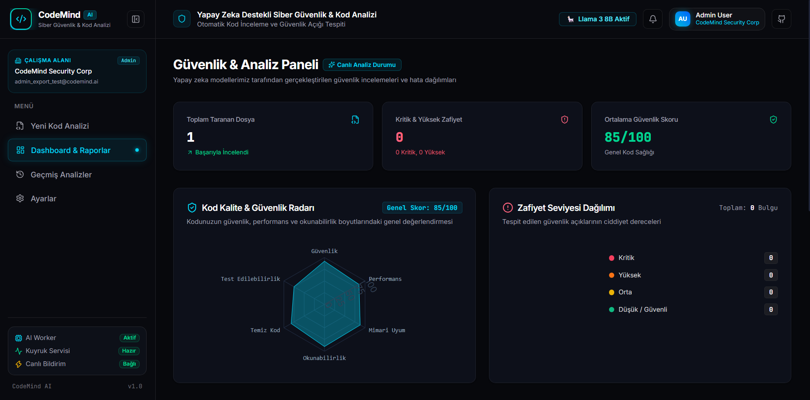
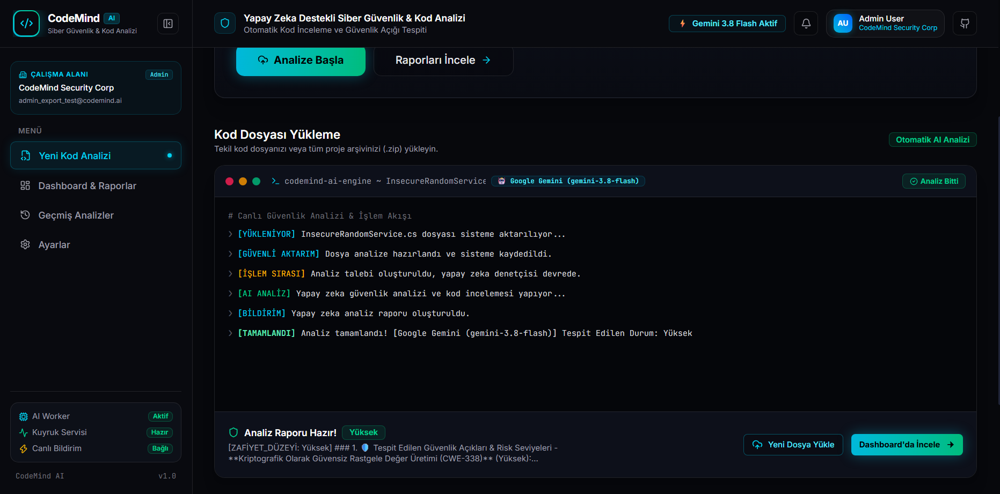
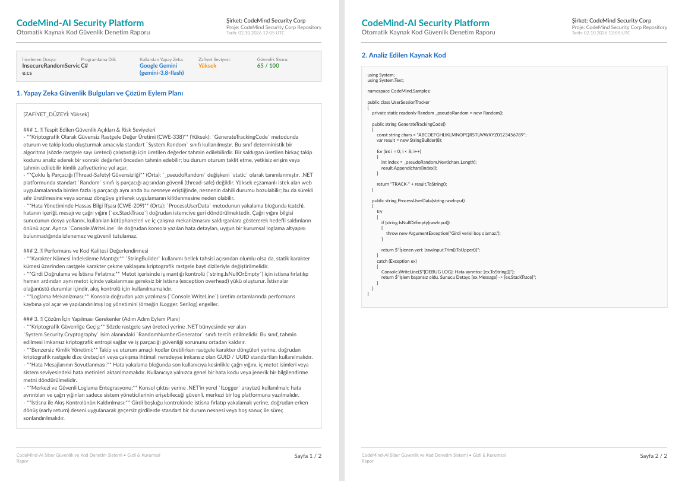
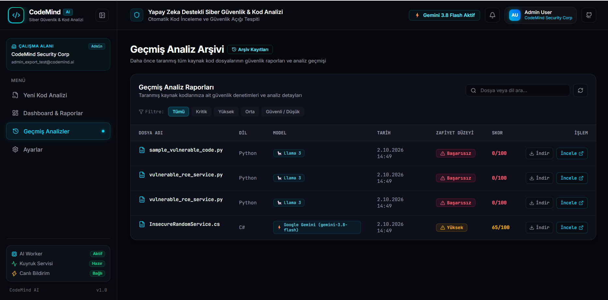

# 🛡️ CodeMind-AI

Kaynak kod üzerinde yapay zekâ destekli güvenlik incelemesi. .NET 10 API, Next.js arayüz, Python 3.11 worker, PostgreSQL, Kafka ve MinIO kullanır.

## Ekran görüntüleri

| Dashboard | Analiz terminali |
| --- | --- |
|  |  |

| PDF raporu | Analiz geçmişi |
| --- | --- |
|  |  |

## İşleyiş

Dosyalar MinIO'ya yüklenir; belge ve kuyruk olayı PostgreSQL'de aynı işlemde kaydedilir. Outbox yayıncısı olayları Kafka'ya iletir. Worker kaynak dosyanın tamamını numaralı parçalara bölerek seçilen modele gönderir ve doğrulanmış, satır numaralı bulgular üretir. Sonuçlar kaydedildikten sonra yetkili kullanıcılara SignalR ile bildirilir; arayüz kaçırılan sonuçları API üzerinden de kontrol eder.

Kodlar ortak bir vektör koleksiyonuna kaydedilmez. Analiz dosya bazındadır; dosyalar arası veri akışı, CVE veritabanı sorgulaması veya eksiksiz SAST kapsamı sağlamaz. Bulgu bulunmaması kodun güvenli olduğunu kanıtlamaz. Skorlar dosya önem seviyesinden hesaplanan gösterge değerleridir.

## Yetkiler ve veri saklama

- Şirket ayrımı EF Core sorgu filtreleriyle uygulanır. PostgreSQL RLS politikası kullanılmaz.
- Admin ve Auditor şirketin raporlarını görebilir. Developer kendi yüklediği dosyalara erişir. Yükleme ve iptal Admin/Developer içindir.
- Parola ve rol değişikliği veya kullanıcı silinmesi mevcut oturumları geçersiz kılar. Geçici parolayla girişte parola değişimi zorunludur.
- Bulut model anahtarları tarayıcı belleğinde ve API'nin iş kimliğine bağlı geçici belleğinde tutulur; API tarafındaki süre sınırı 24 saattir. İş tamamlanınca veya iptal edilince kaldırılır. Sayfa yenilemede tekrar anahtar girilir. API yeniden başlarsa bekleyen bulut işleri anahtarlarını kaybeder ve yeniden yüklenmeleri gerekir.
- Bulut modeli seçildiğinde kaynak kod seçilen sağlayıcıya gönderilir. Ollama seçildiğinde yapılandırılan Ollama sunucusunda işlenir. Kaynak dosyalar MinIO'da, hesaplar ve raporlar PostgreSQL'de saklanır.
- Şirket silme işlemi ilişkili dosyaları, eski embedding kayıtlarını ve uygulama kayıtlarını temizler. Depolama yedekleri ayrıca yönetilmelidir.

## Yerel kurulum

Docker Engine ve Docker Compose gereklidir. Windows'ta `start.bat`, Linux/macOS'ta `bash start.sh` çalıştırın. Betikler `.env.example` üzerinden `.env` oluşturur, eksik JWT ve worker sırlarını üretir ve servisleri başlatır. `.env` Git'e eklenmemelidir.

Arayüz: http://localhost:3000 · API: http://localhost:5083 · Sağlık kontrolü: http://localhost:5083/health

Kayıt ekranından şirket ve ilk Admin hesabını oluşturun. Demo hesaplar varsayılan olarak oluşturulmaz; yalnızca Development ortamında `SeedDemoData=true` ile etkinleştirilebilir.

Yerel model için Ollama'yı başlatın ve `ollama pull llama3` çalıştırın. Docker worker için `OLLAMA_DOCKER_URL`, yerelde çalışan worker için `OLLAMA_BASE_URL` kullanılır. Bulut sağlayıcı anahtarını arayüzde girin; model kullanılabilirliği sağlayıcı hesabınıza bağlıdır. Gerçek sağlayıcı model kimlikleri `OPENAI_MODEL`, `ANTHROPIC_MODEL`, `GEMINI_MODEL` ve `GROQ_MODEL` ile yapılandırılır. Bir model erişilemezse başka bir modele otomatik geçilmez.

İsteğe bağlı yönetim araçları: `docker compose --profile tools up -d`. PostgreSQL, MinIO ve yönetim aracı portları yalnızca localhost'a bağlanır. API ve arayüz portları dış arayüzlere açıktır.

## Geliştirme ve kontroller

- API: `dotnet run --project src/CodeMind.Api`
- Arayüz: `cd frontend`, `npm ci`, `npm run dev` (3050 portu)
- Worker: `cd CodeMind.AIWorker`, Python 3.11 sanal ortamında `pip install --require-hashes -r requirements.lock`, `python main.py`
- .NET regresyon: `dotnet run --project tests/CodeMind.Regression`
- PostgreSQL entegrasyon kontrolleri: aynı komutta `TEST_DATABASE_CONNECTION` tanımlayın. Veritabanı adı `_test` ile bitmelidir; bu veritabanına migration uygulanır.
- Worker testleri: worker dizininde `python -m unittest discover -s tests -v`
- Arayüz: `npm run lint`, `npx tsc --noEmit`, `npm run build`. Turbopack'in çalışmadığı ortamlarda `npm run build -- --webpack` kullanılabilir.

GitHub Actions iş akışı backend, PostgreSQL entegrasyon kontrolleri, Python testleri ve arayüz derlemesini çalıştırır.

## Mevcut kurulumdan yükseltme

Veritabanı ve MinIO yedeği alın. API başlangıçta migration uygular. Yeni migration normalize edilmiş e-posta adreslerini benzersiz yapar; çakışan eski adresler varsa yükseltme durur ve bu kayıtların düzeltilmesi gerekir. Mevcut JWT'ler yeni güvenlik damgası kontrolünden geçmez; kullanıcılar yeniden giriş yapmalıdır. Sahibi bilinmeyen eski belgeler Admin/Auditor tarafından erişilebilir; Developer'a otomatik atanmaz.

## İşletim

Compose dosyası yerel geliştirme içindir. İnternet yayını için HTTPS, gerçek alan adı/CORS ayarları, güçlü veritabanı/depolama parolaları, yedekleme ve izleme yapılandırın. Altyapı imajları digest ile, Python paketleri `requirements.lock` içindeki hash ve sürümlerle sabitlenmiştir; güvenlik güncellemelerinde bu sabitlemeleri bilinçli olarak yenileyin; mevcut veritabanı volume'ünü farklı PostgreSQL ana sürümüne doğrudan bağlamayın.

API geçici anahtar kasası ve SignalR grupları süreç belleğindedir; mevcut yapı tek API örneği içindir. Kafka yeniden teslim yapabilir; tamamlanmış veya iptal edilmiş belgeler tekrar yazılmaz. Kalıcı hatalı mesajlar dead-letter konularına gider; bunların takibi ve kontrollü yeniden işlenmesi işletim sorumluluğudur. İptal, devam eden sağlayıcı çağrısını anında kesmez; yeni parçaların işlenmesini ve sonucun kaydedilmesini engeller.

Şirket silme, dosya yükleme ve yönetici değiştirme işlemleri aynı şirket satırında kilitlenir; eşzamanlı istekler kaynak dosya temizliğini veya son yönetici kuralını atlayamaz.

Tek kaynak dosyası en fazla 1 MB, ZIP içeriği en fazla 100 desteklenen dosya ve toplam 20 MB açılmış içerik olabilir. UTF-8 kaynak kod beklenir.

## ⚖️ Telif Hakkı & Mülkiyet (Copyright & License)

Bu projenin tüm hakları, kaynak kodları, tasarımı ve sistem mimarisi **Aytek Aksu**'ya aittir.

- 👤 **Geliştirici:** [Aytek Aksu (GitHub)](https://github.com/Aytekseng)
- 💼 **LinkedIn:** [linkedin.com/in/aytek-aksu](https://www.linkedin.com/in/aytek-aksu/)
- 📬 **İletişim / Lisanslama:** [aytek_aksu09@hotmail.com](mailto:aytek_aksu09@hotmail.com)
- 📂 **Portfolyo & İnceleme:** Proje kodları kişisel portfolyo, eğitim, mimari inceleme ve teknik değerlendirme amacıyla GitHub üzerinde sergilenmektedir.
- 🚫 **Kullanım Kısıtlamaları:** Projenin tamamı veya herhangi bir bölümü; eser sahibinin yazılı izni olmaksızın ticari amaçlarla kullanılamaz, kopyalanamaz, yeniden dağıtılamaz veya başka platformlarda kaynak gösterilmeden yayımlanamaz.

Copyright © 2026 **Aytek Aksu (@Aytekseng)**. Tüm Hakları Saklıdır (All Rights Reserved).
